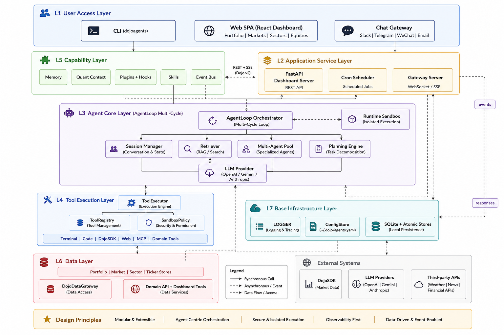
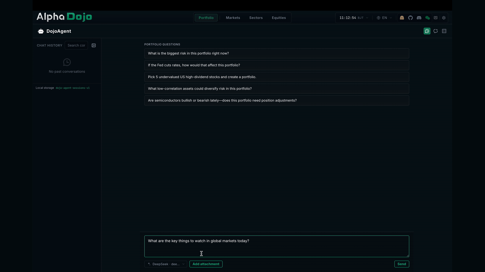
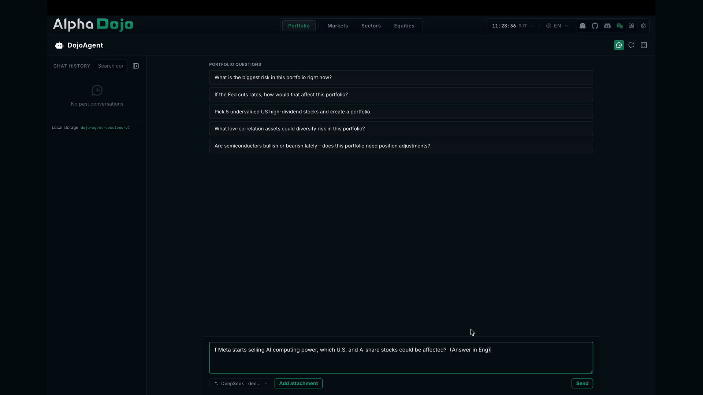
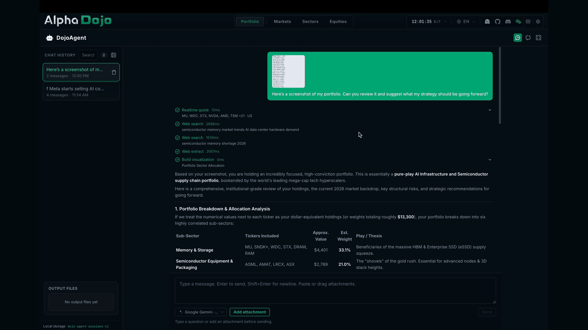
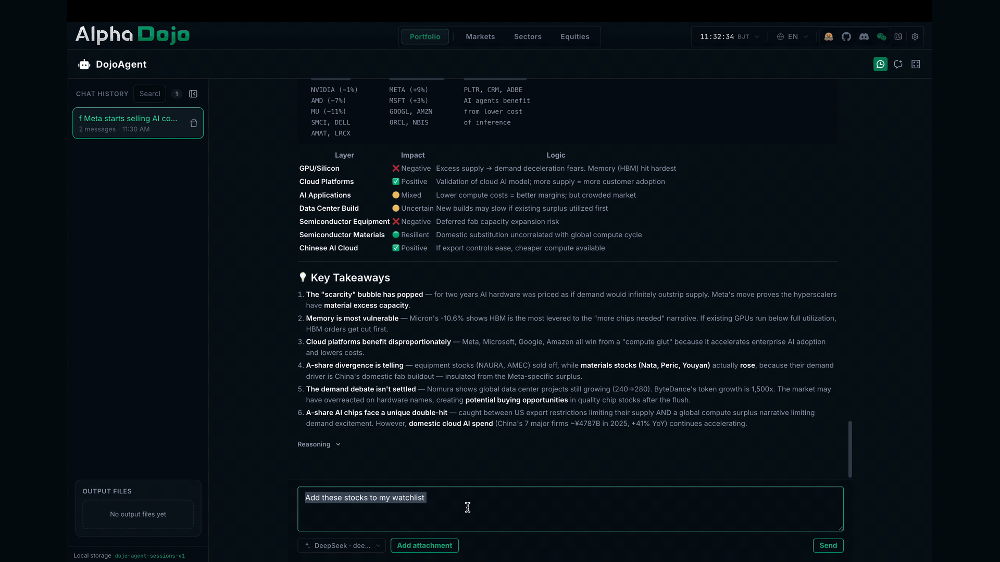

<div align="center">
    <picture>
    <source
      media="(prefers-color-scheme: dark)"
      srcset="dojoagents/dashboard/web/src/assets/images/logo.svg"
    />
    <source
      media="(prefers-color-scheme: light)"
      srcset="dojoagents/dashboard/web/src/assets/images/logo-dark.svg"
    />
    
  </picture>
</div>

<p align="center">
  <a href="https://discord.gg/CCRvSvdvr"></a>
  <a href="docs/site/en/community/wechat.md"></a>
  <a href="https://huggingface.co/AlphaDojo"></a>
  <a href="https://github.com/Alpha-Dojo/DojoAgents/blob/main/docs/README.md"></a>
</p>

<p align="center">
  <a href="README.md">English</a> · <a href="README_ZH.md">中文</a> · <b>Türkçe</b>
</p>

---

# DojoAgents: Kişisel Yatırım için Tüm Piyasaları Kapsayan Yapay Zekâ Yardımcı Pilotu

DojoAgents, kişisel yatırım için özel olarak tasarlanmış, tüm piyasaları kapsayan bir yapay zekâ ajan çatısıdır. Bireysel yatırımcılar ile kurumsal düzeydeki araçlar arasındaki boşluğu kapatmak amacıyla geliştirilen sistemin asıl gücü, son teknoloji bir Agent Loop (Ajan Döngüsü) motorudur. Basit bir gösterge paneli yerine DojoAgents, portföyünüzün yanında yaşayan ve tüm piyasa verilerini anlamlandırmaktan piyasalar arası dinamik strateji çıkarımına kadar her adımı yöneten otonom bir akıl yürütme ajanı konuşlandırır.

<div align="center">
  
  <p><em>Yedi katmanlı mimari — CLI, Web Paneli ve Sohbet Ağ Geçitlerinden Agent Loop üzerinden araçlara, verilere ve altyapıya.</em></p>
</div>

> 🚀 **Kendi sunucunuzda barındırmak istemiyor musunuz?**
>
> [AlphaDojo'yu ücretsiz deneyin!](https://alphadojo.ai/app/?utm_source=github&utm_medium=readme_top&utm_campaign=dojoagents)
>
> [AlphaDojo hakkında daha fazla bilgi edinin →](https://alphadojo.ai/?utm_source=github&utm_medium=readme_top_lp&utm_campaign=dojoagents)

## ✨ Neden DojoAgents?

**🧠 Döngü Tabanlı Bilişsel Portföy Ajanı (Çekirdek Motorumuz):** Çoğu finansal yapay zekâ aracı hızlı çıktılar için tasarlanmıştır: haber özetleri, tek hisse açıklamaları, temel gösterge okumaları veya genel piyasa yorumları. Döngü Tabanlı Bilişsel Portföy Ajanımız portföy farkındalığına sahip akıl yürütme için geliştirilmiştir; varlıklarınızı piyasa verileriyle ilişkilendirir ve dört boyutta yapılandırılmış analiz yürütür:
* **Temel Veri Bilişi:** Çoklu piyasa ham verilerini (mum grafikleri, finansal tablolar, haberler) anında çeker, yapılandırır ve çapraz doğrular.
* **İleri Mantık Analizi:** Gizli piyasa dinamiklerini ortaya çıkarmak için değerleme bantlarını, momentum göstergelerini ve sektör taksonomisini yorumlar.
* **Piyasalar Arası Strateji Çıkarımı:** Makro varlık dağılımı oluşturur ve piyasa bağlantılarını haritalar (örneğin, çok adımlı araç yürütmesiyle *"ABD yarı iletken yazılımları düşerken A-hisseleri neden yükseldi?"* sorusunu otonom olarak akıl yürüterek yanıtlar).
* **Dinamik Portföy Yönetimi:** Daha bilinçli yeniden dengeleme kararlarını desteklemek için risk maruziyetini sürekli teşhis eder, net varlık eğrilerini izler ve performans katkısını değerlendirir.

**📊 Dört Sütunlu Gösterge Paneli:** Kutudan çıktığı anda kullanıma hazır, kurumsal düzeyde React SPA arayüzü:
- **Portföy (Komuta Merkezi):** Net varlık eğrileri, canlı risk maruziyeti ve akıllı pozisyon takibi.
- **Piyasalar:** Piyasalar arası ısı haritaları (ABD / Hong Kong / A-hisseleri) ve endeks takibi.
- **Sektörler:** Derinlemesine L1/L2/L3 taksonomisi ve momentum eğrileri.
- **Hisseler:** Mum grafikleri (K-line), F/K bantları, finansallar ve haberler — hepsi tek bir birleşik görünümde.

**🤖 Otonom Kantitatif Analist:** Çoklu ajan iş birliğiyle güçlendirilmiştir; siz uyurken arka planda otonom piyasa araştırması yapar, sektör rotasyonlarını izler ve risk maruziyetinizi takip eder.

**📱 Planlanan Çok Kanallı Güncellemeler:** Gelecek sürümler Slack, Telegram, Discord, Feishu, WeChat veya e-posta üzerinden kişiselleştirilmiş günlük bültenleri ve uyarı bildirimlerini destekleyecektir.

## 📈 DojoAgents Neler Yapabilir?

### 1. Günlük Piyasa Özeti

*"Bugün küresel piyasalarda neyi izlemeye değer?"* — yatırımcıların her sabah sorduğu en yaygın sorulardan biri. Bunun arkasında piyasalar arası hareketler, sektör rotasyonu, hisse anomalileri, piyasa duyarlılığı ve olası katalizörler yatar.

DojoAgents bir veri toplama aşamasına girerek A-hisseleri, ABD hisseleri ve Hong Kong hisselerindeki öne çıkan hareketleri, güç sıralamalarını, fiyat değişimlerini, hacim kaymalarını ve sektör dağılımını çekmek için küresel piyasa, sektör ve hisse araçlarını çağırır. Çalışma boyunca herhangi bir ara adımı genişleterek hangi araçların çağrıldığını, hangi verilerin kaynak gösterildiğini ve analizin nasıl ilerlediğini görebilirsiniz.

<div align="center">
  
</div>

### 2. Haber Etki Analizi

Son dakika bir haber düştüğünde ilk soru her zaman şudur: *hangi hisseler etkilenecek?*

Meta'nın son yapay zekâ altyapısı hamlelerini ele alalım — A-hissesi yatırımcıları doğal olarak şu soruyu sordu: *"Meta işlem gücü kapasitesi satıyor — hangi ABD ve A-hisseleri etkilenebilir?"* DojoAgents soruyu alt parçalara ayırır; ardından piyasa, haber, şirket ve sektör araçlarıyla veri toplar: Meta'nın fiyat hareketi, ilgili başlıklar, piyasa performansı ve ABD teknolojisi, yapay zekâ işlem gücü zincirleri, yarı iletkenler, bulut ve reklam teknolojisi gibi segmentler.

<div align="center">
  
</div>

### 3. Ekran Görüntüsünden Portföy Teşhisi

DojoAgents çok kipli (multimodal) modelleri destekler — portföyünüzün ekran görüntüsünü yükleyin ve eksiksiz bir portföy teşhisi alın. Elle veri girişi gerekmez.

A-hisseleri, ABD hisseleri ve ETF'leri kapsayan 40'tan fazla pozisyon içeren bir ekran görüntüsü yükleyin. DojoAgents her varlığı tanır; piyasa, sektör ve tedarik zinciri konumuna göre yeniden gruplar, ardından aşırı yoğunlaşma, örtüşen risk maruziyeti ve yetersiz savunma varlıklarını işaretleyen bir risk teşhisi üretir. 40'tan fazla hisse olmasına rağmen birçok pozisyon fiilen aynı temaya bahis oynamaktadır; yarı iletkenlerde, yapay zekâ işlem gücünde veya büyüme hisselerinde yaşanacak geniş çaplı bir geri çekilme tüm portföyü birlikte aşağı çekebilir.

<div align="center">
  
</div>

### 4. Önerilerden Simüle Edilmiş Portföy

Teşhisin ardından DojoAgents takip stratejileri önerir — yinelenen pozisyonları azaltma, çekirdek hisseleri koruma, ABD dağılımını optimize etme, zayıf maruziyetleri düşürme ve kamu hizmetleri ile temel tüketim gibi savunma varlıkları ekleme. Önerileri onayladığınızda yeni bir izleme portföyü oluşturabilir ve bunu Gösterge Panelinde sürekli takip edebilirsiniz.

<div align="center">
  
</div>

## 🚀 Hızlı Başlangıç

DojoAgents ortamınızı kurmak zahmetsiz olacak şekilde tasarlanmıştır. Yıldırım hızında bağımlılık yönetimi için `uv` kullanmanızı şiddetle öneririz.

### 1. Gereksinimler

- **Python** >= 3.11
- **Node.js**: >= 18 (ön yüz derlemesi için)
- **npm**: >= 9
- Bir LLM **API Anahtarı** (OpenAI, Gemini, Anthropic vb.)

### 2. Temel Kurulum

#### Hızlı Kurulum (PyPI)

Çoğu kullanıcı için yayımlanmış paketi doğrudan kurun — depo klonlama veya ön yüz derlemesi gerekmez:

```bash
# macOS / Linux
uv venv && source .venv/bin/activate
uv pip install dojoagents

# Windows (PowerShell)
uv venv && .venv\Scripts\Activate.ps1
uv pip install dojoagents

# Windows (CMD)
uv venv && .venv\Scripts\activate.bat 
uv pip install dojoagents
```

Ardından [Sunucuyu Başlatma](#4-sunucuyu-başlatma) adımına geçin.

#### Kaynak Koddan Kurulum (Geliştiriciler)

Çalışma zamanı bağımlılıkları hem `pyproject.toml` hem de `requirements.txt` dosyalarında listelenir.

```bash
# 1. Sanal ortam oluşturun ve etkinleştirin
uv venv && source .venv/bin/activate

# 2. Geliştirme araçlarıyla "düzenlenebilir kipte" kurun. Kaynak kodda yapılan tüm değişiklikler
# anında geçerli olur — özel araçlar geliştirmek veya Agent Loop hata ayıklamak için idealdir.
uv pip install -e ".[dev]"
```

### 3. Gösterge Paneli Derlemesi

DojoAgents Gösterge Paneli, Vite ile güçlendirilmiş yüksek performanslı bir React SPA'dır; OpenAI uyumlu sohbet API'si ve dinamik Canvas grafik çizimi için SSE akışı üzerinden FastAPI arka ucuyla iletişim kurar.

Kaynak koddan derliyorsanız Node.js (>= 18) ve npm (>= 9) gereklidir.
```bash
cd dojoagents/dashboard/web
npm install
npm run build
```

### 4. Sunucuyu Başlatma

```bash
dojoagents dashboard --host 127.0.0.1 --port 8765
```

Kişisel finansal komuta merkezinize erişmek için tarayıcınızda `http://127.0.0.1:8765/` adresini açın.

### 5. LLM Motorunuzu Yapılandırma (Uygulama İçi)

Gösterge paneli açıldığında Ayarlar (Settings) simgesine tıklayın. DojoAgents, tercih ettiğiniz Büyük Dil Modellerini güvenli biçimde yapılandırmanız için kapsamlı bir grafik arayüz sunar.

- **Desteklenen Sağlayıcılar**: OpenAI, Anthropic, Google Gemini, Zhipu GLM ve DeepSeek için hazır ön ayarlar.
- **Yerel ve Özel Uç Noktalar**: Ollama, llama.cpp veya vLLM gibi yerel örneklere bağlanmak için Base URL'leri kolayca geçersiz kılın.
- **Güvenli Depolama**: Arayüzde girilen tüm API anahtarları ve uç nokta ayarları yerel `~/.dojo/agents.yaml` dosyanıza güvenle yazılır.

## 🧠 Çekirdek Mimari

Yukarıdaki diyagramda gösterildiği gibi DojoAgents; ölçeklenebilirlik, derin bağlamsal akıl yürütme ve tam gizlilik için tasarlanmıştır.

- **Agent Loop Motoru:** Çekirdek akıl yürütme çalışma zamanı. Çok turlu araç orkestrasyonunu, bağlam penceresi sıkıştırmasını ve finansal halüsinasyonları önleyen sıkı koruma sınırlarını yönetir.
- **Yürütme Korumalı Alanı (Execution Sandbox):** Anlık Python kodu çalıştırma, teknik gösterge hesaplamaları ve yerel web verisi çıkarma için güvenli ve izole bir ortam.
- **Bellek ve BECERİLER (SKILLS):** Başarılı, çok adımlı piyasa analizi iş akışlarını gelecekteki yürütmeler için yeniden kullanılabilir, programatik BECERİLER hâline otomatik olarak damıtır.
- **Cron ve Ağ Geçidi (Gateway):** Ana Ajan akıl yürütme döngüsünü engellemeden, zamanlanmış ve otomatik içgörüleri doğrudan tercih ettiğiniz sohbet uygulamalarına ileten ayrıştırılmış teslimat hatları.

### Harness Çalışma Zamanı

Her ajan örneği tam olarak bir Harness örneğine bağlıdır. Çekirdek (Core) LLM döngüsüne, araç yürütmesine, yaşam döngüsüne ve kullanıcı kapsamlı Oturum (Session) platformuna sahiptir; Harness ise tek bir senaryonun kimliğini, istemlerini (prompts), becerilerini, araçlarını, belleğini, politikalarını, görevlerini, sunucularını, servislerini ve yüzey bağdaştırıcılarını yönetir. Yerleşik finansal senaryo varsayılan olarak seçilidir:

```yaml
harness:
  id: financial
  factory: dojoagents.harnesses.built_in.financial:create_harness
  config:
    backend: sdk
```

Diğer projeler bir Python Harness fabrikası sağlayabilir veya kısıtlı `dojoagents/v1alpha1` bildirim biçimi için `factory: null` ve `manifest: ./my-harness.yaml` ayarlayabilir. Ek beceri/araç dizinleri bağlı Harness'ı tamamlar ve onun sahip olduğu bileşenlerin yerini sessizce alamaz.

Finansal Harness ajan davranışını (istemler, ToolSpec'ler, politikalar, bellek, görevler ve sonuç sunumu) yönetir. FastAPI Gösterge Paneli ise finansal uygulama arka ucunu (yönlendiriciler, API şemaları, depolar, yenileme/ön hesaplama işleri, portföy verileri ve servis yaşam döngüsü) bağımsız olarak yönetir. Gömülü Gösterge Paneli kurulumları mevcut finansal arka uçlarını Runtime içine bağlar; CLI veya Ağ Geçidi kurulumları bağımsız SDK arka ucunu veya yapılandırılmış bir uzak HTTP arka ucunu kullanabilir.

Oturumlar `(tenant_id, user_id, session_id)` kapsamında izole edilir ve dosya ya da proje tarafından sağlanan depoları kullanabilir. Çevrimiçi MySQL/PostgreSQL/nesne depolama kurulumları için [harici SessionStore / BlobStore bağdaştırıcı sözleşmesine](docs/site/en/design/session-store-adapter.md) bakın.

## 📚 Belgeler ve Derinlemesine Rehberler

Özel kantitatif beceriler oluşturmaya, tescilli verileri entegre etmeye veya çoklu ajan sürüsü konuşlandırmaya hazır mısınız? Kapsamlı geliştirici rehberlerimize göz atın:

- Sistem Mimarisi ve Tasarım Felsefesi
- Özel Eklentiler ve Claude Becerileri Yazma
- Sohbet Ağ Geçitleri ve Çok Kanallı Kurulum
- Gösterge Paneli Arayüz Özelleştirme Kılavuzu
- [Harici SessionStore / BlobStore bağdaştırıcıları](docs/site/en/design/session-store-adapter.md)

## 🤝 Katkıda Bulunma

En iyi açık kaynaklı finansal yapay zekâyı birlikte inşa ediyoruz ve yardımınızı bekliyoruz! Yeni araçlar eklemek, ajan istemlerini geliştirmek veya piyasa kapsamını genişletmek için Katkı Yönergelerimize göz atın.

**Lisans:** DojoAgents, Apache License 2.0 altında açık kaynaklıdır.

## ⚠️ Sorumluluk Reddi

Bu proje yalnızca eğitim, araştırma ve gösterim amaçlıdır; yatırım tavsiyesi veya alım-satım önerisi sunmaz. Finansal araçlarda işlem yapmak sermaye kaybı olasılığı dahil önemli riskler içerir. Tüm veriler, analizler ve çıktılar yalnızca referans amaçlıdır; doğru, eksiksiz veya güncel olmayabilir. Kullanıcılar kendi yatırım kararlarından sorumludur; bu proje ve katkıda bulunanlar, sağlanan bilgilere güvenilmesinden doğan hiçbir kayıptan sorumlu tutulamaz. Üçüncü taraf adları, logoları ve markaları yalnızca tanımlama amaçlı kullanılır ve herhangi bir onay veya bağlılık anlamına gelmez.
